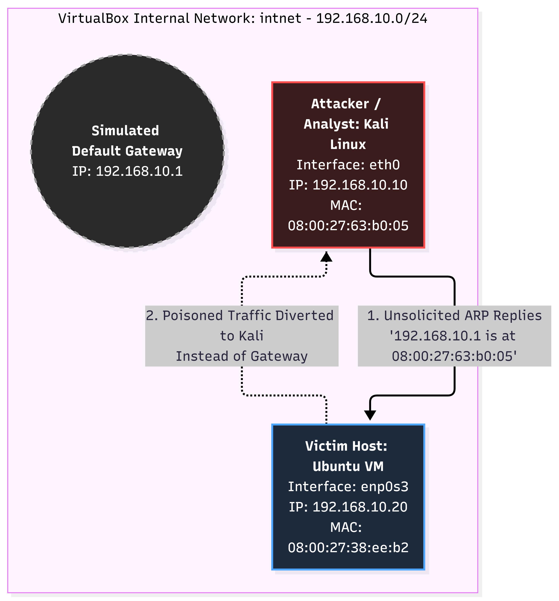
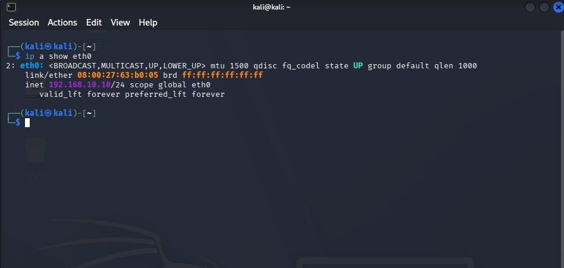
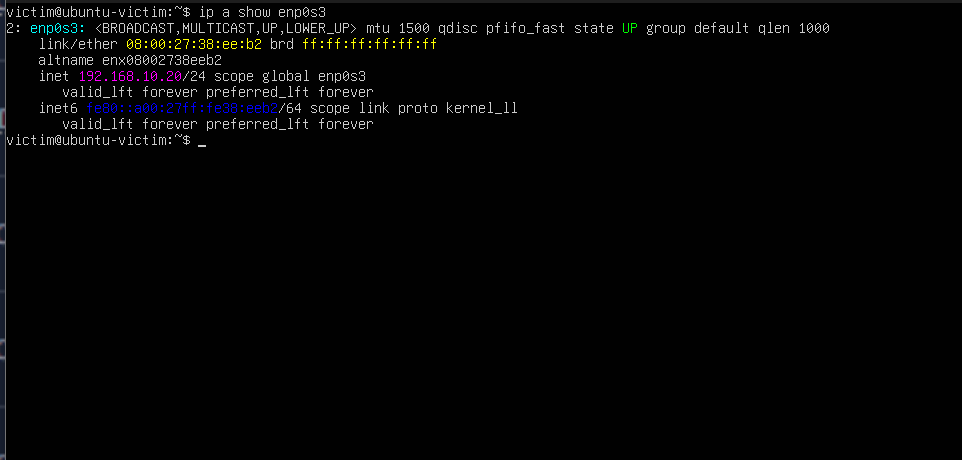
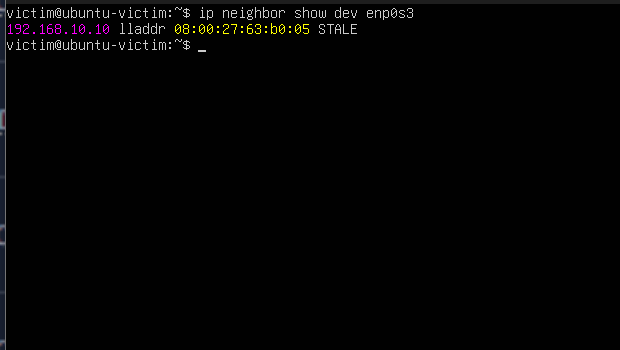
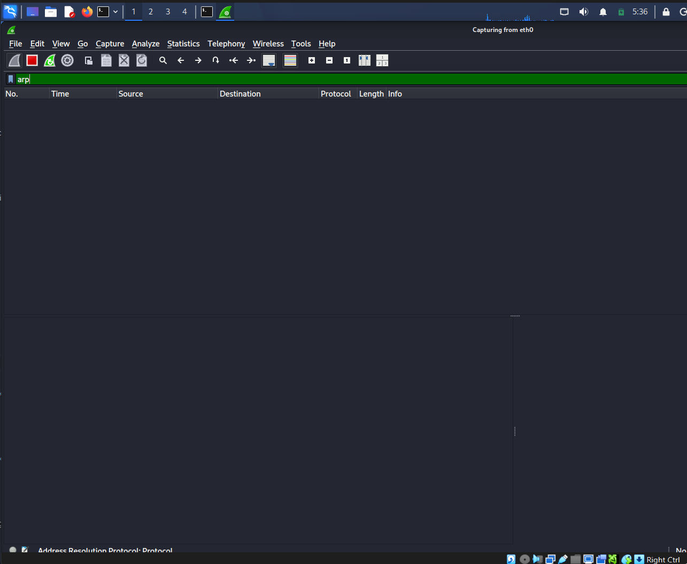
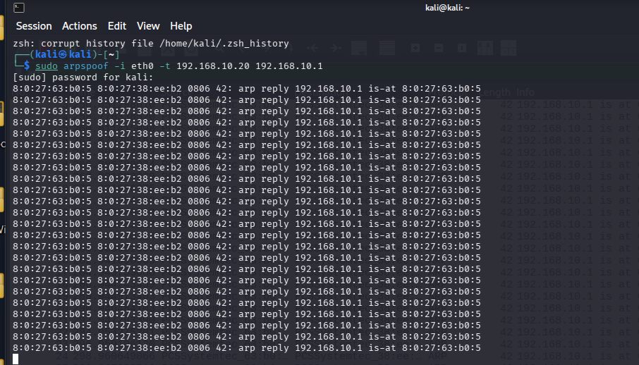
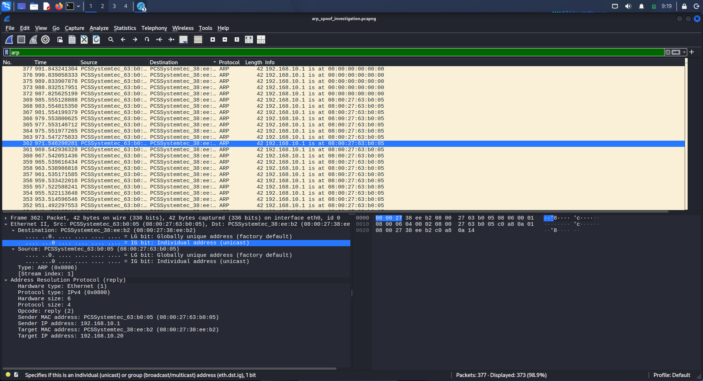
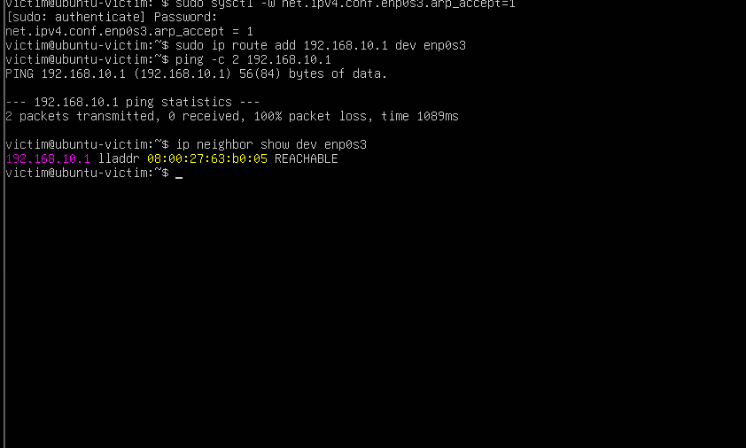
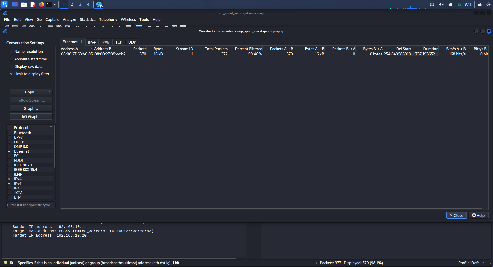

# ARP Spoofing Attack Detection with Wireshark

## Objective
This project sets out to detect and analyze Layer 2 Address Resolution Protocol (ARP) cache poisoning (MITRE ATT&CK T1557.002). It matters because ARP is a stateless protocol lacking native authentication, meaning hosts inherently trust unsolicited replies. This vulnerability allows an adversary to forge MAC-to-IP bindings, successfully establishing a Man-in-the-Middle (MitM) position to intercept, modify, or block local network traffic.

## Environment
The simulation was conducted inside an isolated VirtualBox internal network (`intnet` - `192.168.10.0/24`) to contain broadcast traffic safely:

| Role | OS | IP Address | MAC Address |
| :--- | :--- | :--- | :--- |
| **Attacker / Analyst** | Kali Linux (`eth0`) | `192.168.10.10` | `08:00:27:63:b0:05` |
| **Victim Host** | Ubuntu VM (`enp0s3`) | `192.168.10.20` | `08:00:27:38:ee:b2` |
| **Spoofed Target** | Simulated Gateway | `192.168.10.1` | *Impersonated by Attacker* |



## MITRE ATT&CK Mapping
* **T1557.002:** Adversary-in-the-Middle: ARP Cache Poisoning
* **Tactics:** Credential Access, Collection
* **Data Sources:** Network Traffic (Packet Capture), Host ARP Cache Inspection

## Attack Execution
To emulate the adversary, network interfaces were verified and baseline communications established. Static configurations confirmed endpoint identities before initiating the attack workflow.

First, Kali Linux and Ubuntu verified interface parameters and baseline ARP connectivity:

* **Kali IP Configuration:**
  ```bash
  ip a show eth0
  ```
  

* **Ubuntu IP Configuration:**
  ```bash
  ip a show enp0s3
  ```
  

* **Baseline ARP Table (Before Attack):**
  Prior to execution, Ubuntu's clean neighbor table mapped legitimate local hosts correctly without anomalies.
  ```bash
  ip neighbor show
  ```
  

Next, Wireshark packet capture was initialized on Kali's `eth0` interface to record broadcast frames:

* **Wireshark Capture Start:**
  

The adversary emulation loop was then triggered using `arpspoof` to flood continuous forged replies claiming the gateway IP:

* **Attack in Progress:**
  ```bash
  sudo arpspoof -i eth0 -t 192.168.10.20 192.168.10.1
  ```
  

## Detection Methodology
Wireshark display filters were utilized to isolate anomalous ARP traffic patterns from normal network operations:

* **Filter by Opcode:** Using `arp.opcode == 2` filters directly for ARP replies, quickly exposing reply floods where endpoints receive unsolicited responses without preceding `who-has` requests.
* **Filter by Duplicate IP/MAC Mapping:** Inspecting packets reveals two distinct physical MAC addresses claiming ownership of `192.168.10.1`.
* **Traffic Flow Analysis:** Checking conversation statistics via **Statistics -> Conversations** uncovers extreme packet count imbalances characteristic of automated spoofing scripts.

## Evidence / Indicators of Compromise
Packet forensic inspection and host cache evaluation confirmed total cache corruption:

* **Attacker MAC:** `08:00:27:63:b0:05`
* **Victim IP:** `192.168.10.20` (`08:00:27:38:ee:b2`)
* **Spoofed Gateway IP:** `192.168.10.1`
* **Traffic Volume:** Over 300 unilateral forged ARP replies transmitted within a short inspection window.
* **Packet Capture Artifact:** [`arp-spoof-capture.pcapng`](arp-spoof-capture.pcapng) (available in repository root for Wireshark inspection)

* **Wireshark Spoofed Replies:**
  

* **ARP Table After Attack:**
  Inspection on Ubuntu confirmed `192.168.10.1` was successfully overwritten and bound to Kali's hardware address.
  ```bash
  ip neighbor show
  ```
  

* **Traffic Statistics:**
  Protocol hierarchy and conversation statistics highlight abnormal ARP frame concentration.
  

## Detection & Response (Mitigation)
In an enterprise environment, mitigation requires a defense-in-depth approach across switches and endpoints:

1. **Dynamic ARP Inspection (DAI):** Deploy DAI on enterprise access layer switches. DAI inspects incoming ARP packets against a trusted DHCP Snooping binding database and drops invalid unsolicited replies.
2. **DHCP Snooping:** Enable DHCP Snooping on switches to establish a trusted table of IP-to-MAC assignments across network switchports.
3. **Static ARP Tables:** For critical static infrastructure (such as default gateways or core DNS servers), configure static ARP entries to prevent dynamic cache overwrite.
4. **Endpoint Hardening (Linux Sysctl):** Configure kernel parameters to restrict ARP response behavior and ignore gratuitous/unsolicited announcements:
   ```bash
   net.ipv4.conf.all.arp_ignore = 1
   net.ipv4.conf.all.arp_announce = 2
   ```

## Key Takeaway
This simulation demonstrates how Layer 2 protocols can be exploited when authentication is absent, and how security analysts detect and dissect Man-in-the-Middle positioning at the packet level. By combining behavioral traffic anomaly detection with Layer 2 enterprise switch hardening, organizations can prevent and detect ARP spoofing attacks before adversaries achieve eavesdropping or traffic manipulation objectives.